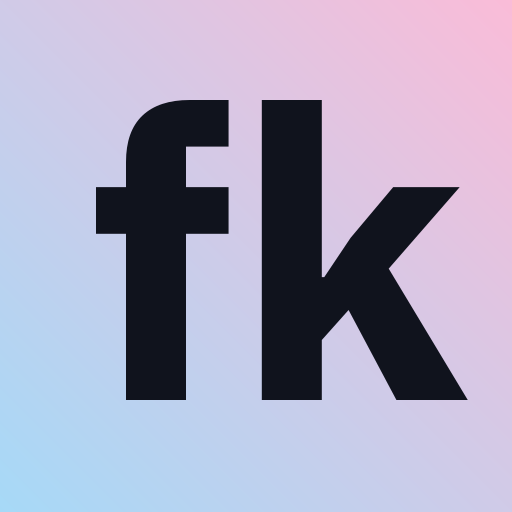

# fluorokit

A Metro theme for shadcn-svelte. Add components with the shadcn-svelte CLI as
usual and import a fluorokit theme: the components take the look, and nothing
is forked. It also adds Metro pieces that shadcn-svelte doesn't have (tiles, a
pivot, the type scale, a direction-aware page-enter), which also work as plain
CSS without Svelte.

The structure is the same in each project: zero radius, a light-weight type
scale, one left edge. A theme is a palette and a set of fonts.

## Install

```sh
npm install fluorokit
```

## Showcase site

The showcase and the theme builder are in a separate repo,
[fluorokit-site](https://github.com/abbyfluoroethane/fluorokit-site), live at
<https://fluorokit.bigaouette.com/>.

## Presets and the command

A preset is six named choices, as a short code: `f009000`. The create page of
the site makes the code. The command writes the theme of a code:

```sh
npx fluorokit theme --preset f009000 --out src/theme.css
npx fluorokit theme --preset f009000 --format json --out tokens/themes/mine.json
```

`--format` is `shadcn` (CSS with the shadcn names, the default), `css` (the
fluorokit variables only) or `json` (a theme file for the kit).

## Build

```sh
npm run build
```

| File | Contents |
| --- | --- |
| `dist/structure.css` | Spacing, shape, type scale and motion |
| `dist/themes/<name>.css` | One theme: colors and fonts |
| `dist/themes/<name>.shadcn.css` | The same theme, plus the shadcn variable names |
| `dist/base.css` | Type classes, the energy bar, status, the pivot, `.fk-enter` |
| `dist/tailwind.css` | Tailwind 4 `@theme` mapping for shadcn-svelte |
| `dist/shiki/<name>-<scheme>.json` | A Shiki syntax theme for code blocks, for a theme that has syntax colors |
| `dist/adobe/<name>-<mode>.ase` | An Adobe swatch file of each mode, for Illustrator, InDesign and Photoshop |
| `dist/fonts/selawik.css` | The Selawik font, for the `zune` theme |
| `dist/tools/` | The theme recipe (`fluoro.mjs`), the presets (`presets.mjs`) and the CSS writer (`theme-css.mjs`), as modules for the browser or Node |
| `dist/enter.js` | `setEnterDirection`, for a direction-aware page-enter |
| `dist/motion.js` | `leave`, `continuum`, `continuumIn`, `attachTilt`, `attachPanorama` |
| `dist/svelte/` | Svelte 5 components: `Pivot` |

Every fluorokit variable and class has the `fk` prefix (`--fk-base`,
`.fk-title`). The shadcn names `--muted` and `--accent` mean different things
from `--fk-muted` and `--fk-accent`, so the two sets do not share a namespace.

## Use

Plain CSS:

```js
import 'fluorokit/structure.css';
import 'fluorokit/themes/catppuccin.css';
import 'fluorokit/base.css';
```

Tailwind 4 with shadcn-svelte:

```css
@import 'tailwindcss';
@import 'fluorokit/structure.css';
@import 'fluorokit/themes/zune.shadcn.css';
@import 'fluorokit/tailwind.css';
@import 'fluorokit/base.css' layer(components);
```

The `components` layer lets Tailwind utilities override the kit's classes.

Selawik, the sans font of the `zune` theme, is included (SIL Open Font
License 1.1):

```css
@import 'fluorokit/fonts/selawik.css';
```

IBM Plex is not included. For a theme that names it, the project supplies
the `@font-face` rules, from `@fontsource/ibm-plex-sans` for example.

## Sizes

Every size in the kit is in rem: type, spacing, tiles, the page margin and
motion. So the root font size sets the scale of the whole page. The kit
sets no root size of its own; with no attribute, `1rem` is the browser's
size (16px unless the reader changed it).

For another scale, put a preset on the root element:

```html
<html data-fk-size="compact">
```

| Preset | Root size | For |
| --- | --- | --- |
| none | browser default (16px) | most sites |
| `compact` | 81.25% (13px) | dense desktop apps |
| `large` | 112.5% (18px) | reading pages, kiosks, a television |
| `wide` | 16px, then 110%, 120% and 130% from 1500, 1800 and 2200px wide | sites that should use more of a big screen |

The presets are percentages of the browser's size, so a reader who set a
larger default still gets a larger page.

## Page-enter and pivots

Put `.fk-enter` on content that mounts when the page changes. It fades in
while it slides 80px into place. Set `--i` (0, 1, 2 ...) on siblings to
stagger them.

For page content, put `.fk-enter-children` on the element that holds it. Each
direct child then enters after the header, with no class of its own:

```html
<main class="fk-enter-children">...</main>
```

The slide is direction-aware by default. `Pivot` sets `--fk-enter-dir` on the
root element at each click: 1 when the new header is to the right, -1 when it
is to the left. Thus a page comes from the side its header lies on. This is
the same for a top-level pivot and a subpivot.

```svelte
<script>
  import Pivot from 'fluorokit/svelte/Pivot.svelte';
  let page = $state('music');
</script>

<Pivot items={['music', 'videos', 'pictures']} bind:value={page} size="subpivot" />
{#key page}
  <section class="fk-enter">...</section>
{/key}
```

When code changes the page (a menu command, a shortcut), call
`setEnterDirection(items, from, to)` from `fluorokit/enter` before the
change. To keep the direction local, give `Pivot` a `scope` element, or set
`--fk-enter-dir` on a container.

On a site of separate pages (Astro), the direction comes from the page the
visitor came from. Put this in the `<head>`, with the section roots in the
order of the nav:

```astro
---
import { enterDirectionScript } from 'fluorokit/enter';
---
<script is:inline set:html={enterDirectionScript(['/', '/blog/', '/projects/'])} />
```

A section further right comes from the right, and one further left from the
left. In one section, a deeper page comes from the right and the way back
from the left.

## Page-exit, continuum, tilt and bleed type

These need `fluorokit/motion` for the script parts. The styles are in
`base.css`.

**Page-exit.** The old page leaves before the new page enters. `.fk-exit`
fades out and slides away from the side the new page comes from. It is
faster than the enter and uses an ease-in. `.fk-turnstile-out` and
`.fk-turnstile-in` swing the element on its left edge. `leave(el)` adds the
class and resolves when the animation ends:

```js
import { setEnterDirection } from 'fluorokit/enter';
import { leave } from 'fluorokit/motion';

setEnterDirection(pages, current, next);
await leave(pageEl, { kind: 'turnstile', children: true });
current = next; // remount the page: the old element stays hidden
```

With `children: true`, each direct child leaves a stagger apart, top to
bottom. `Pivot` does this for you: give it the page element as `leaving`.

```svelte
<Pivot items={pages} bind:value={page} leaving={pageEl} exit="slide" />
{#key page}
  <section class="fk-enter" bind:this={pageEl}>...</section>
{/key}
```

**Continuum.** The tapped item becomes the header of the next page. The
rest of the page leaves, top to bottom, and the item stays. On the next
page, the header starts where the item was, at the size of the item, and
moves and grows into place:

```js
import { continuum, continuumIn } from 'fluorokit/motion';

await continuum(item.querySelector('.title'), { page: listEl, kind: 'slide' });
open(item); // mount the next page
continuumIn(nextPage.querySelector('h1'));
```

"The rest of the page" is each sibling of the item, then each sibling of
its parent, up to `page`. For the way back, call `continuum()` on the
header and `continuumIn()` on the list item. With `.fk-continuum-in` alone
and no `continuum()` before it, the header slides in from the left.

On a site of separate pages, `continuum()` returns where the item is.
Keep it in `sessionStorage` and give it to `continuumIn(el, { from })` on
the next page.

Make sure no ancestor of the new header has an animation that moves it,
because the header then moves twice. `.fk-continuum-in` overrides
`.fk-enter-children` on a direct child and on a grandchild only.

**Tilt.** Put `.fk-tilt` on a tile or a button and call `attachTilt()` once.
A pressed element tips toward the press point and sinks when the press is
near its center. It follows the pointer while it is down, and lets go when
the pointer leaves it. Without the script, `:active` gives a flat press.

**Bleed type.** `.fk-bleed` sets one word at `--fk-bleed-size`, too big for
the screen. Put it in a `.fk-bleed-frame`, which clips it, so the page does
not scroll sideways. `data-crop="top"` also cuts the top of the letters.

```html
<div class="fk-bleed-frame"><h1 class="fk-bleed" data-crop="top">marketplace</h1></div>
```

**Panorama.** A wide canvas in three layers: the sections move with the
finger, the background slower and the title slowest. Call
`attachPanorama(el)` on the `.fk-panorama` element. The markup is in the
comment above `.fk-panorama` in `base.css`.

**The page gutter.** The panorama spans the screen from edge to edge, so
the kit must know the page padding. `--fk-page-gutter` is the left padding
and `--fk-page-gutter-end` the right. The default is the page margin, down
to 1rem on a narrow screen. Use the tokens for the page padding, or set
them to the padding the page has:

```css
main { padding-inline: var(--fk-page-gutter) var(--fk-page-gutter-end); }
```

`.fk-full-bleed` pulls any element out to both screen edges, and
`.fk-bleed-end` to the right edge only. Both reach the screen edge only
when no ancestor between the element and the padded box has a max-width.

With `prefers-reduced-motion`, the exit, the turnstile and continuum do not animate,
tilt dims the element instead of moving it, and the panorama layers stay
still.

## Themes

| Theme | Modes | Follows the OS setting |
| --- | --- | --- |
| `catppuccin` | `mocha` (default), `latte`, `paper` (print) | Yes |
| `ink`, `blueberry`, `twilight`, `cobalt` | `freon` (default, dark), `teflon` (light), `paper` (print) | Yes |
| `zune` | `light` (default), `dark` | No: the app sets the mode |

Select a mode with `data-theme="<mode>"` on the root element. The `.dark` and
`.light` classes also select the mode with that color scheme.

Tailwind's `dark:` variant applies under `.dark` or `data-theme="dark"`. With
`catppuccin` in a shadcn-svelte project, put `.dark` on the root element for Mocha.

`ink`, `blueberry`, `twilight` and `cobalt` are the fluoro family, the house
palette. They share light pink and light blue accents and strong tiles with
white text, and differ in the base: `ink` is almost black, `blueberry` a
saturated blue, `twilight` a rich violet, `cobalt` a brighter blue. They are
generated: edit the recipe in `scripts/make-fluoro.mjs`, then run
`node scripts/make-fluoro.mjs && npm run build`. The script prints the
contrast of each text and fill pair.

A mode can have a `syntax` object (comment, keyword, string, number and so
on). The build writes a Shiki theme from it, `fluorokit/shiki/ink-dark.json`
for example, with the mode's text color as the default and no background.

A theme can have a `tiles` object. Each entry becomes `--fk-tile-<name>`, a
tile fill that is the same in each mode. `tileText` becomes `--fk-tile-text`,
the text color on a tile.

## Print

Each theme mode is also an Adobe swatch file: `dist/adobe/ink-teflon.ase`
for example. Open it from the Swatches panel. The swatches are sRGB, in
groups by role (surfaces, text, accents, status, charts, syntax, tiles).
The printer's profile turns them into CMYK when you export.

`tokens/print/business-card.json` is the type scale for a business card
(US, 3.5 x 2 in): the web scale at 8 pt to the rem, with print limits.
Nothing is smaller than 6 pt. Type of 9 pt and smaller prints in black
only (K), because four inks cannot hold registration at that size.

## Add a theme

Copy a file in `tokens/themes/`. Each mode must define each color in the
`REQUIRED` list in `scripts/build.mjs`. `chart-4` and `chart-5` are optional.
To give a shadcn variable a value that no fluorokit color has, put it in the
mode's `shadcn` object.

## Credits

The logo (`logo/`) is set in IBM Plex Sans Bold, outlined.


The `catppuccin` theme uses colors from [Catppuccin](https://github.com/catppuccin/catppuccin) (MIT).

Selawik is copyright Microsoft Corporation, under the SIL Open Font License
1.1 (`src/fonts/selawik/LICENSE.txt`).
